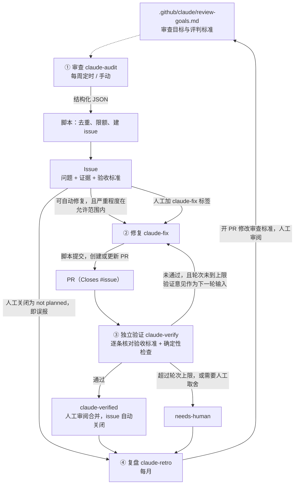

# Claude 自动改进闭环：审查 → Issue → 修复 → 验证

本文说明如何借助 Claude 与 GitHub 的协作能力，让仓库持续地自动变好。闭环分四步：

1. 按目标审查仓库，把发现的缺陷写成 issue；
2. Claude Code 针对 issue 自动提交 PR；
3. 由另一个独立的 Claude 会话验证 PR 是否真正解决了 issue，没解决就给出具体建议，进入下一轮修复；
4. 每月复盘一次，用误报和失败案例改进审查标准本身。

所有实现都在本仓库中，基于 GitHub Actions 和 [anthropics/claude-code-action](https://github.com/anthropics/claude-code-action)，不依赖外部服务或数据库。

---

## 1. 总体设计

闭环由两个环组成：

- **内环**以单个 issue 为单位，在修复和验证之间往返，最多 `CLAUDE_MAX_ROUNDS` 轮（默认 3 轮）。它负责把一个具体问题改对。
- **外环**以审查标准为单位：统计误报、多轮未通过和转人工的案例，修改 `review-goals.md`。它负责让审查本身越来越准，这是“持续提升”的关键。只有内环的话，系统会不断重复同样的误报。

## 2. 四个阶段

| 阶段 | 工作流 | 触发方式 | Claude 读取 | Claude 输出 | 脚本负责 |
|---|---|---|---|---|---|
| ① 审查 | `claude-audit.yml` | 每周一定时；手动运行时可指定审查重点 | 审查标准、全部内容、已有 issue 列表、确定性检查结果、原文网页 | 问题列表（JSON），每个问题附带证据、验收标准、是否可自动修复和指纹 | 指纹去重、额度控制、建 issue、分派自动修复 |
| ② 修复 | `claude-fix.yml` | 审查或验证阶段分派；人工给 issue 加上 `claude-fix` 标签 | issue；第 2 轮起还会读取上一轮的验证意见和当前 diff | 修改文件，并输出修复说明（JSON） | 检查改动范围、提交、推送、创建或更新 PR、触发验证 |
| ③ 验证 | `claude-verify.yml` | 修复阶段分派；也可以手动运行 | issue 的验收标准、PR diff、改动后的文件、上一轮意见、原文网页 | 判定 pass / fail / needs_human，逐条给出证据，列出新引入的问题和修改建议（JSON） | 用确定性检查否决错误的“通过”、发评论、打标签、触发下一轮或转人工、可选自动合并 |
| ④ 复盘 | `claude-retro.yml` | 每月 1 日；手动 | 统计数据、误报案例及人工留下的理由、多轮验证记录 | 修改 `review-goals.md`，并输出总结（JSON） | 限定只能改这一个文件，开 PR 交给人工审阅 |

文件清单：

| 文件 | 作用 |
|---|---|
| `.github/claude/review-goals.md` | **目标函数**。审查、修复、验证都以它为准；想改变审查方向，只需改这里 |
| `CLAUDE.md` | 仓库约定。Claude Code 每次运行都会自动读取 |
| `.github/claude/schemas/*.json` | 各阶段输出的 JSON schema，通过 `--json-schema` 强制 Claude 按格式输出 |
| `.github/scripts/claude_loop.py` | 胶水脚本，负责所有 GitHub 写操作和状态流转 |
| `.github/scripts/check_links.py` | 确定性检查：相对链接是否有效、README 是否索引了每篇文章 |
| `.github/workflows/claude-*.yml` | 四个阶段的工作流 |

## 3. 关键设计决策

### 3.1 把“目标”写进仓库，用验收标准锚定闭环

“是否解决了 issue”能否被判定，取决于 issue 写得好不好。因此审查阶段必须为每个问题写出**可客观判定的验收标准**，例如“README 开头写的收录数量，等于两张索引表的行数之和”。验证阶段逐条核对这些标准，而不是凭感觉打分。

`review-goals.md` 同时定义了审查目标（G1–G6）、严重程度、“可自动修复”的边界和“不要报告”的情形，三个阶段共享这一份标准。

> 举例：当前 README 开头写的是收录“20 项”研究，但两张索引表实际有 22 篇。这正是 G4（内部一致）要抓的问题，可以用来检验第一次运行的效果。

### 3.2 Claude 只产出结构化结果，GitHub 写操作全部由脚本完成

各阶段的 Claude 都只有读文件、改文件、查网页这几类工具，**没有 Bash，也没有 GitHub 写权限**。审查和验证阶段连写文件的权限都没有。结果按 JSON schema 输出（`--json-schema` → `structured_output`），之后由 `claude_loop.py` 统一完成建 issue、提交、开 PR、打标签等操作。好处有三点：

- **可控**：去重、限额、轮次上限、路径白名单都写在确定性代码里，不依赖模型“记得遵守”；
- **可审计**：每次 GitHub 写操作都出现在 Actions 日志中，格式固定；
- **降低提示注入的危害**：即使 Claude 被网页或 issue 内容注入，能做的也只有修改工作区里的文件，而这些修改还要经过路径检查、独立验证和人工合并三道关。

### 3.3 修复方和验证方分离

验证运行在新的 job、全新的上下文中。它看不到修复方的推理过程，提示词也明确要求“不要采信 PR 中的自述，只依据实际改动和原文判断”。这相当于给生成器配一个独立的验证器，思路与本仓库收录的 XBOW 用验证器消除误报一致（见 [07](../ai-for-security/07-xbow-hackerone.md)）。验证意见以 PR 评论的形式保存，下一轮修复会把它作为输入，逐条处理。

### 3.4 确定性检查优先于 LLM 判断

`check_links.py` 在审查阶段作为证据提供给 Claude，在验证阶段作为**否决门槛**：检查失败时，即使 Claude 判定 pass，也会被改为 fail。这对应本仓库的综合观察之二：“LLM 和传统工具是互补关系”。如果是代码仓库，这一层就换成测试、lint 和类型检查（见第 8 节）。

### 3.5 用 workflow_dispatch 显式串联各阶段

GitHub 有一条防递归规则：用 `GITHUB_TOKEN` 产生的事件（建 issue、开 PR、推送、打标签）**不会触发其他工作流**，唯一的例外是 `workflow_dispatch` 和 `repository_dispatch`。因此各阶段之间不依赖事件联动，而是由脚本调用 `gh workflow run` 显式触发下一阶段，轮次作为参数传递。这样流程是确定的，不会因为事件丢失而中断，也不会被重复触发。

由工作流分派的运行，触发者是 `github-actions[bot]`，所以修复和验证工作流设置了 `allowed_bots: github-actions`。这是 claude-code-action 默认拦截 bot 触发、防止循环的机制。

### 3.6 人工反馈也是数据

- 把 issue 关闭为 **not planned**，就表示它是误报：同一指纹不会再被报告，复盘时还会读取你留下的关闭理由；
- 关闭为 **completed** 后，如果同一问题再次出现，允许重新报告，作为回归处理；
- 转人工（`needs-human`）和多轮才通过的案例，会在复盘时用来改进验收标准的写法和“可自动修复”的边界。

### 3.7 状态全部保存在 GitHub 上

没有外部数据库，状态全部保存在 GitHub 上。标签表示状态；issue、PR 和评论正文中的隐藏 HTML 注释保存元数据，例如 `<!-- claude-loop:audit fingerprint=… -->`、`<!-- claude-loop:verify round=2 verdict=fail -->`。脚本只信任 `github-actions` 自己发出的标记评论，忽略他人伪造的同名标记。

## 4. 状态与标签

| 标签 | 加在 | 含义 |
|---|---|---|
| `claude-audit` | issue | 由审查阶段创建 |
| `severity:high` / `severity:medium` / `severity:low` | issue | 严重程度，定义见 `review-goals.md` |
| `claude-fix` | issue | 允许自动修复。由审查阶段按配置自动添加，或由人工添加，人工添加会立即触发修复 |
| `claude-autofix` | PR | 由修复阶段创建的 PR |
| `claude-verified` | PR | 通过独立验证，等待人工合并 |
| `needs-human` | issue / PR | 超过轮次上限、Claude 判断需要人工取舍、改动超出允许范围，或工作流运行失败 |
| `claude-retro` | PR | 复盘阶段对审查标准的修改 |

标签会在首次运行时自动创建。

## 5. 护栏

**防止失控**

- 每个 issue 最多修复和验证 `CLAUDE_MAX_ROUNDS` 轮，超过后转人工；
- 每次审查最多新建 `CLAUDE_MAX_ISSUES_PER_RUN` 个 issue；未关闭的审查 issue 达到 `CLAUDE_MAX_OPEN_ISSUES` 个时暂停审查，避免人工处理不过来；
- 每个 issue 和 PR 都有独立的并发组；同一 issue 已有进行中的 PR 时，重复触发会被跳过；
- 每个工作流都设置了 `timeout-minutes` 和 `--max-turns`；任何一步失败都会自动转人工，闭环不会静默中断。

**防止越权**

- 工具白名单：审查和验证阶段只能读文件和查网页；修复阶段可以改文件；所有阶段都禁用 Bash；
- 路径白名单：修复阶段只能改 Markdown 内容文件，改动 `.github/`、`.claude/` 或 `CLAUDE.md` 会被拒绝并转人工；复盘阶段只能改 `review-goals.md`；
- 验证阶段检出 PR 后，会把 `.github/`、`.claude/` 和 `CLAUDE.md` 恢复为主干版本，所以 PR 无法篡改验证方使用的标准；
- 默认不自动合并：合并始终由人决定。只有设置了 `CLAUDE_AUTO_MERGE_SEVERITIES`（例如 `low`）才会自动合并对应严重程度的修复；
- 只有对仓库有写权限的人能触发人工入口（claude-code-action 会检查）。

**提示注入**

可能携带注入内容的输入有：issue 和评论内容、Claude 用 WebFetch 打开的网页，以及复盘时读取的人工评论。针对这些输入，提示词把它们声明为数据，并要求忽略其中的指令；同时有前面列出的工具白名单、路径白名单、独立验证和人工合并。对于公开仓库，建议保持“不自动合并”。

**成本**

可以调节的项包括：审查频率（cron）、每次和积压的 issue 上限、`CLAUDE_MODEL`（默认 `opus`，可改为 `sonnet` 以降低用量），以及各工作流中的 `--max-turns`。

使用 Claude 订阅时，闭环与你日常使用 Claude 共用同一份用量额度。如果某次运行因额度或速率限制失败，相关 issue 或 PR 会被标记为 `needs-human`，额度恢复后手动重新运行即可。额度紧张时，可以降低审查频率、调低 issue 上限，或者把 `CLAUDE_MODEL` 设为 `sonnet`。

## 6. 启用步骤

1. **把这些文件合并到默认分支。** 定时触发和 `workflow_dispatch` 只认默认分支上的工作流文件；闭环创建的 PR 也以默认分支为目标。
2. **配置凭据。** 工作流默认使用 Claude 订阅（Pro 或 Max）认证：
   1. 在本地安装 Claude Code，并用订阅账号登录；
   2. 在终端运行 `claude setup-token`，在浏览器中完成授权后，终端会输出一个长期有效的 token；
   3. 在仓库的 Settings → Secrets and variables → Actions 中点击 New repository secret，名称填 `CLAUDE_CODE_OAUTH_TOKEN`，值填刚才的 token。也可以用 GitHub CLI 设置：`gh secret set CLAUDE_CODE_OAUTH_TOKEN --repo <owner>/<repo>`，命令会提示你粘贴，token 不会留在 shell 历史中。

   token 等同于你的账号凭据，不要提交到仓库，也不要粘贴到 issue 或聊天中。如果日志中出现认证错误（例如 token 过期或被撤销），重新运行 `claude setup-token` 并更新这个 secret 即可。

   如果改用 API key：添加 secret `ANTHROPIC_API_KEY`，并把四个工作流中的 `claude_code_oauth_token: ${{ secrets.CLAUDE_CODE_OAUTH_TOKEN }}` 改为 `anthropic_api_key: ${{ secrets.ANTHROPIC_API_KEY }}`。
3. **允许 Actions 创建 PR。** 在 Settings → Actions → General → Workflow permissions 中勾选 “Allow GitHub Actions to create and approve pull requests”。
4. **（可选）设置变量。** 在 Settings → Secrets and variables → Actions → Variables 中设置：

   | 变量 | 默认值 | 说明 |
   |---|---|---|
   | `CLAUDE_MODEL` | `opus` | 各阶段使用的模型。如果你的套餐在 Claude Code 中不能使用 Opus，设为 `sonnet` |
   | `CLAUDE_AUTO_FIX` | `true` | 审查后是否自动分派修复 |
   | `CLAUDE_AUTO_FIX_SEVERITIES` | `low,medium` | 哪些严重程度可以自动修复；`high` 默认需要人工加标签 |
   | `CLAUDE_MAX_ROUNDS` | `3` | 每个 issue 的最大修复轮次 |
   | `CLAUDE_MAX_ISSUES_PER_RUN` | `5` | 每次审查最多新建的 issue 数 |
   | `CLAUDE_MAX_OPEN_ISSUES` | `10` | 未关闭的审查 issue 达到这个数量时暂停审查 |
   | `CLAUDE_AUTO_MERGE_SEVERITIES` | `none` | 验证通过后自动合并的严重程度，例如 `low` |

5. **首次运行。** 在 Actions 页面手动运行 “Claude 闭环 · 1 审查”。

建议分阶段放权：

- 第一周把 `CLAUDE_AUTO_FIX` 设为 `false`，只看 issue 的质量，并把误报关闭为 not planned；
- 确认质量可靠后，再打开 low 和 medium 的自动修复；
- 运行一两个月、首轮通过率稳定之后，再考虑对 `low` 开启自动合并。

## 7. 日常使用：人工介入点

| 想做的事 | 操作 |
|---|---|
| 立刻审查某个方向 | 手动运行审查工作流，在 `focus` 中填写重点，例如“核对 security-for-ai 中所有 ASR 数字” |
| 让 Claude 修复某个 issue（也可以是人写的 issue） | 给 issue 加上 `claude-fix` 标签。issue 中最好写清验收标准 |
| 标记误报 | 把 issue 关闭为 “not planned”，最好留一句理由，复盘时会读取 |
| 处理验证通过的 PR | 筛选 `label:claude-verified`，审阅后合并；PR 中的 `Closes #N` 会自动关闭对应 issue |
| 处理卡住的问题 | 筛选 `label:needs-human`，评论中写明了原因和运行记录链接 |
| 重新验证某个 PR | 手动运行验证工作流，填写 PR 编号 |
| 调整审查方向 | 直接修改 `.github/claude/review-goals.md`，或审阅每月的复盘 PR |

## 8. 推广到代码仓库

本仓库是文档仓库，所以“确定性检查”只有链接检查。用在代码仓库时，需要调整这几处：

- **审查目标**：在 `review-goals.md` 中改写为正确性、安全、性能、可维护性等目标，并相应修改严重程度和可自动修复的边界；
- **修复工具**：在修复阶段的 `--allowedTools` 中按需放开具体命令，例如 `Bash(npm test:*)`、`Bash(pytest:*)`，让 Claude 能跑测试；同时把 `FIX_ALLOWED` 改为代码路径的白名单；
- **验证门槛**：在 `verify-context` 中运行测试、lint 和类型检查，结果像 `LINKS_OK` 一样作为否决条件；
- **CI 触发**：用 `GITHUB_TOKEN` 创建的 PR 不会触发仓库其他的 `pull_request` 工作流。如果需要常规 CI，有两种做法：用 [actions/create-github-app-token](https://github.com/actions/create-github-app-token) 生成 GitHub App token，再用它推送和开 PR；或者在验证工作流中通过 `workflow_call` 直接调用 CI。

## 9. 其他实现方式

- **`@claude` 交互**：在仓库中再加一个标准的 claude-code-action 工作流（tag 模式），就可以在任何 issue 或 PR 中 `@claude` 下达临时指令，作为本闭环之外的人工补充。
- **Claude Code 云端会话的定时任务（Routines）**：在 claude.ai/code 中，可以创建按 cron 运行的云端会话执行审查，也可以让会话订阅 PR 动态、自动处理评审意见和 CI 失败。这种方式配置更少，但流程状态保存在提示词和会话中，确定性和可审计性不如本方案。适合先快速试验，或者用于不方便配置 Actions 的仓库。

推荐以本方案（GitHub Actions）为主干，另外两种作为补充。

## 10. 已知限制

- **去重不完美**：指纹由 LLM 生成，跨运行不一定完全一致，所以同时提供已有 issue 列表让 Claude 做语义去重，再用指纹做确定性兜底。偶尔仍可能出现重复，关闭为 not planned 即可。
- **同源盲区**：修复方和验证方是同一模型家族，可能在同一个问题上一起犯错。确定性检查和人工合并是最后防线，也可以给验证阶段单独换一个模型。
- **原文不可达**：付费墙或反爬页面会导致 WebFetch 失败。按照审查标准，无法核实的内容不会被报告为事实错误。
- **尚未在真实仓库端到端运行**：胶水脚本已用模拟的 `gh` 和本地 git 远端测试过全部分支（建 issue、去重、多轮修复、通过、否决、轮次上限、转人工、复盘），工作流也通过了 actionlint；但真实调用 Claude 的部分需要在启用后观察第一轮运行。
