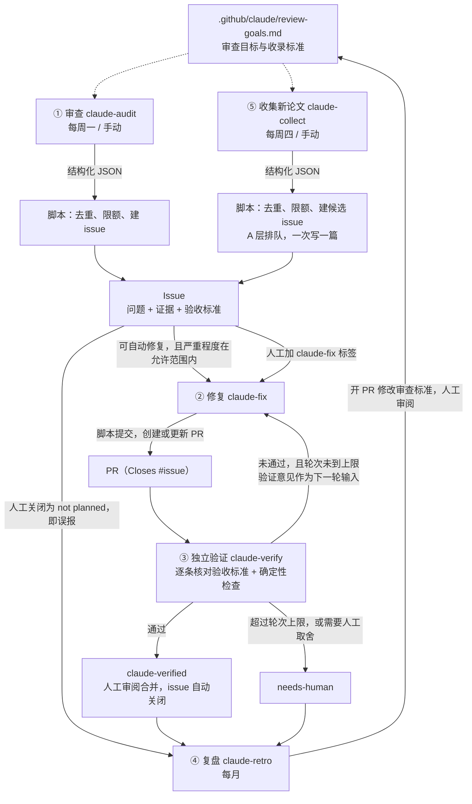

# Codex 自动改进闭环：审查 → Issue → 修复 → 验证

本文说明如何借助 Codex 与 GitHub 的协作能力，让仓库持续地自动变好。闭环有两个入口和三个后续步骤：

1. **审查**：按目标审查已有内容，把发现的缺陷写成 issue；
2. **收集**：定期在四大安全会议上搜索新发表的 LLM 安全论文，把值得收录的写成 issue；
3. Codex 针对 issue 自动提交 PR（修复缺陷，或撰写新论文的精读）；
4. 由另一个独立的 Codex 会话验证 PR 是否真正解决了 issue，没解决就给出具体建议，进入下一轮修复；
5. 每月复盘一次，用误报、被否决的候选和失败案例改进审查与收录标准本身。

GitHub Actions 通过 [Codex GitHub Action](https://learn.chatgpt.com/docs/github-action) 和配置的 Responses API 代理调用模型，流程状态保存在 GitHub 上。

---

## 1. 总体设计

现有工作流文件名、标签、分支、隐藏标记和流程变量沿用 `claude` 命名，已有 issue、PR、论文队列和历史验证意见可以继续使用。

闭环由两个环组成：

- **内环**以单个 issue 为单位，在修复和验证之间往返，最多 `CLAUDE_MAX_ROUNDS` 轮（默认 3 轮）。它负责把一个具体问题改对。
- **外环**以审查标准为单位：统计误报、多轮未通过和转人工的案例，修改 `review-goals.md`。它负责让审查本身越来越准，这是“持续提升”的关键。只有内环的话，系统会不断重复同样的误报。

## 2. 五个阶段

| 阶段 | 工作流 | 触发方式 | Codex 读取 | Codex 输出 | 脚本负责 |
|---|---|---|---|---|---|
| ① 审查 | `claude-audit.yml` | 每周一定时；手动运行时可指定审查重点 | 审查标准、全部内容、已有 issue 列表、确定性检查结果、原文网页 | 问题列表（JSON），每个问题附带证据、验收标准、是否可自动修复和指纹 | 指纹去重、额度控制、建 issue、分派自动修复 |
| ② 修复 | `claude-fix.yml` | 审查或验证阶段分派；人工给 issue 加上 `claude-fix` 标签 | issue；第 2 轮起还会读取上一轮的验证意见和当前 diff | 修改文件，并输出修复说明（JSON） | 检查改动范围、提交、推送、创建或更新 PR、触发验证 |
| ③ 验证 | `claude-verify.yml` | 修复阶段分派；也可以手动运行 | issue 的验收标准、PR diff、改动后的文件、上一轮意见、原文网页 | 判定 pass / fail / needs_human，逐条给出证据，列出新引入的问题和修改建议（JSON） | 用确定性检查否决错误的“通过”、发评论、打标签、触发下一轮或转人工、可选自动合并 |
| ④ 复盘 | `claude-retro.yml` | 每月 1 日；手动 | 统计数据、误报和被否决的候选及人工留下的理由、多轮验证记录 | 修改 `review-goals.md`，并输出总结（JSON） | 限定只能改这一个文件，开 PR 交给人工审阅 |
| ⑤ 收集 | `claude-collect.yml` | 每周四定时；手动运行时可指定搜索重点；论文 PR 被人工合并或关闭时分派下一篇 | 收录标准（G7）、已收录论文、已有候选、四大安全会议官方页面和原文 | 候选论文列表（JSON），每篇附带层级、官方核实证据、验收标准，以及本次检查过的来源清单 | 指纹去重、额度控制、建候选 issue、按顺序一次分派一篇撰写 |

文件清单：

| 文件 | 作用 |
|---|---|
| `.github/claude/review-goals.md` | **目标函数**。审查、收集、修复、验证都以它为准；想改变审查或收录方向，只需改这里（收录标准在“G7 持续收录”一节） |
| `AGENTS.md` | 仓库目录、写作和检查约定 |
| `.github/claude/schemas/*.json` | 各阶段的输出 schema，由 Action 的 `output-schema-file` 传给 Codex |
| `.github/claude/codex-config.toml` | 运行时的网页检索和沙箱权限配置 |
| `.github/claude/proxy-models.json` | 代理的模型配置，让 `gpt-6.1-sol` 通过标准 Responses 请求使用文件工具和网页检索 |
| `.github/scripts/codex_loop.py` | 胶水脚本，负责所有 GitHub 写操作和状态流转 |
| `.github/scripts/check_links.py` | 确定性检查：相对链接是否有效、README 是否索引了每篇文章、文章编号是否连续 |
| `.github/workflows/claude-*.yml` | 五个阶段的工作流 |

## 3. 关键设计决策

### 3.1 把“目标”写进仓库，用验收标准锚定闭环

“是否解决了 issue”能否被判定，取决于 issue 写得好不好。因此审查阶段必须为每个问题写出**可客观判定的验收标准**，例如“README 开头写的收录数量，等于各索引表的行数之和”。验证阶段逐条核对这些标准，而不是凭感觉打分。

`review-goals.md` 同时定义了审查目标（G1–G6）、严重程度、“可自动修复”的边界和“不要报告”的情形，三个阶段共享这一份标准。

> 举例：第一次运行时，审查发现 README 开头写的是收录“20 项”研究，而两张索引表实际有 22 篇（G4，内部一致）。闭环自动创建了 issue、提交了修复，验证通过后合并，全程约 3 分钟。

### 3.2 Codex 只产出结构化结果，GitHub 写操作全部由脚本完成

Codex 的最终消息按 JSON schema 生成，通过 Action 的 `final-message` 输出交给 `codex_loop.py`。脚本负责限额、去重、提交、创建 issue 和 PR、打标签，以及分派下一阶段。`GH_TOKEN` 仅在执行这些操作的脚本步骤中可用，检出仓库时也关闭了凭据持久化。

### 3.3 修复方和验证方分离

验证运行在新的 job、全新的上下文中。它看不到修复方的推理过程，提示词也明确要求“不要采信 PR 中的自述，只依据实际改动和原文判断”。这相当于给生成器配一个独立的验证器，思路与本仓库收录的 XBOW 用验证器消除误报一致（见 [07](../ai-for-security/07-xbow-hackerone.md)）。验证意见以 PR 评论的形式保存，下一轮修复会把它作为输入，逐条处理。

### 3.4 确定性检查优先于 LLM 判断

`check_links.py` 在审查阶段作为证据提供给 Codex，在验证阶段作为**否决门槛**：检查失败时，即使 Codex 判定 pass，也会被改为 fail。这对应本仓库的综合观察之二：“LLM 和传统工具是互补关系”。如果是代码仓库，这一层就换成测试、lint 和类型检查（见第 8 节）。

### 3.5 用 workflow_dispatch 显式串联各阶段

GitHub 有一条防递归规则：用 `GITHUB_TOKEN` 产生的事件（建 issue、开 PR、推送、打标签）**不会触发其他工作流**，唯一的例外是 `workflow_dispatch` 和 `repository_dispatch`。因此各阶段之间不依赖事件联动，而是由脚本调用 `gh workflow run` 显式触发下一阶段，轮次作为参数传递。这样流程是确定的，不会因为事件丢失而中断，也不会被重复触发。

修复和验证设置了 `allow-bots: true`，允许内置的 `github-actions[bot]` 调用 Codex。人工触发由 Codex Action 检查仓库写权限。

### 3.6 人工反馈也是数据

- 把 issue 关闭为 **not planned**，就表示它是误报：同一指纹不会再被报告，复盘时还会读取你留下的关闭理由；
- 关闭为 **completed** 后，如果同一问题再次出现，允许重新报告，作为回归处理；
- 转人工（`needs-human`）和多轮才通过的案例，会在复盘时用来改进验收标准的写法和“可自动修复”的边界。

### 3.7 状态全部保存在 GitHub 上

没有外部数据库，状态全部保存在 GitHub 上。标签表示状态；issue、PR 和评论正文中的隐藏 HTML 注释保存元数据，例如 `<!-- claude-loop:audit fingerprint=… -->`、`<!-- claude-loop:verify round=2 verdict=fail -->`。脚本只信任 `github-actions` 自己发出的标记评论，忽略他人伪造的同名标记。

### 3.8 持续收集新论文：只在官方页面核实，一次只写一篇

收集阶段是闭环的第二个入口，把“仓库跟上最新研究”也变成可验证的 issue：

- **标准写在 G7 里**：现阶段只搜索四大安全会议（IEEE S&P、USENIX Security、ACM CCS、NDSS），范围、来源和层级都在 `review-goals.md` 的“G7 持续收录”一节；要扩大范围，只需改这一节。审查阶段不再报告“缺少某篇论文”，避免两个入口重复。
- **录用和获奖必须在官方页面核实**：博客和新闻只能当线索。每次运行还会输出检查过的来源清单（已检查 / 无法访问 / 尚未公布），写在运行摘要里。像 S&P 官方页面无法访问这类覆盖缺口，可以从摘要里直接看到。
- **分层放权**：A 层（获奖论文）符合 README 现有的筛选标准，默认自动排队撰写；B 层（录用且有影响力证据）是编辑判断，需要人工加标签。
- **一次只写一篇**：新文章的编号取“现有最大编号 + 1”，并行撰写会撞号，所以候选论文排成队列，按 issue 编号依次分派。前一篇的 PR 合并、关闭或转人工后，才分派下一篇。触发分派的时机有三个：每周的收集运行、自动合并之后，以及人工合并或关闭论文 PR 时。被人工关闭了 PR 的候选不会被自动重写。
- **通用验收标准由脚本补齐**：每个候选 issue 都会自动附上新文件位置、编号连续、核心小节、数字可溯源、README 索引和计数一致这几条标准。`check_links.py` 也会检查文章编号是否连续且不重复，作为验证阶段的否决条件。

## 4. 状态与标签

| 标签 | 加在 | 含义 |
|---|---|---|
| `claude-audit` | issue | 由审查阶段创建 |
| `severity:high` / `severity:medium` / `severity:low` | issue | 严重程度，定义见 `review-goals.md` |
| `claude-fix` | issue | 允许自动修复。由审查阶段按配置自动添加，或由人工添加，人工添加会立即触发修复 |
| `claude-autofix` | PR | 由修复阶段创建的 PR |
| `claude-verified` | PR | 通过独立验证，等待人工合并 |
| `needs-human` | issue / PR | 超过轮次上限、Codex 判断需要人工取舍、改动超出允许范围，或工作流运行失败 |
| `claude-retro` | PR | 复盘阶段对审查标准的修改 |
| `claude-collect` | issue / PR | 收集阶段发现的候选论文，以及为它撰写精读的 PR |
| `tier:A` / `tier:B` | issue | 候选论文的层级：A 为四大安全会议获奖论文，B 为录用且有影响力证据的论文 |

标签会在首次运行时自动创建。

## 5. 护栏

**防止失控**

- 每个 issue 最多修复和验证 `CLAUDE_MAX_ROUNDS` 轮，超过后转人工；
- 每次审查最多新建 `CLAUDE_MAX_ISSUES_PER_RUN` 个 issue；未关闭的审查 issue 达到 `CLAUDE_MAX_OPEN_ISSUES` 个时暂停审查，避免人工处理不过来；
- 每个 issue 和 PR 都有独立的并发组；同一 issue 已有进行中的 PR 时，重复触发会被跳过；
- 工作流设有 `timeout-minutes`，修复和验证失败时会标记 `needs-human`。

**权限**

- 审查、收集和验证使用只读沙箱。修复阶段可以编辑工作区，提交前由脚本检查改动是否限于 Markdown 内容。复盘沙箱只允许写 `review-goals.md`；
- 查询原文使用 Codex 的实时网页检索，复盘关闭网页检索。各阶段的本地命令均无网络访问权限；
- 验证使用 PR 的实际提交生成 diff，把工作区的自动化配置和 `AGENTS.md` 等约定文件恢复为主干版本。修复和验证运行的脚本也在切换到 PR 内容前保存；
- 默认由人工合并。设置 `CLAUDE_AUTO_MERGE_SEVERITIES` 后，验证通过且严重程度或论文层级符合配置的 PR 可以自动合并。

网页、issue、PR 和评论内容作为待核实的数据交给 Codex。用量随运行次数、模型和调研范围变化，可用 cron 和现有 issue 额度变量控制。

## 6. 启用步骤

1. **把这些文件合并到默认分支。** 定时触发和 `workflow_dispatch` 只认默认分支上的工作流文件；闭环创建的 PR 也以默认分支为目标。
2. **配置代理密钥。** 在仓库的 Settings → Secrets and variables → Actions → New repository secret 中创建 `CODEX_PROXY_API_KEY`，值填代理服务签发的密钥。也可以运行 `gh secret set CODEX_PROXY_API_KEY --repo <owner>/<repo>`，在提示时输入密钥。工作流将请求发到 `https://sri-ai.xyz/v1/responses`，并附带代理要求的 `x-openai-actor-authorization` 请求头。
3. **允许 Actions 创建 PR。** 在 Settings → Actions → General → Workflow permissions 中勾选 “Allow GitHub Actions to create and approve pull requests”。
4. **（可选）设置变量。** 在 Settings → Secrets and variables → Actions → Variables 中设置：

   | 变量 | 默认值 | 说明 |
   |---|---|---|
   | `CODEX_MODEL` | `gpt-6.1-sol` | 五个阶段通过代理使用的模型。覆盖时选用代理支持且兼容 Responses API、结构化输出和网页检索的模型 |
   | `CLAUDE_AUTO_FIX` | `true` | 审查后是否自动分派修复 |
   | `CLAUDE_AUTO_FIX_SEVERITIES` | `low,medium` | 哪些严重程度可以自动修复；`high` 默认需要人工加标签 |
   | `CLAUDE_MAX_ROUNDS` | `3` | 每个 issue 的最大修复轮次 |
   | `CLAUDE_MAX_ISSUES_PER_RUN` | `5` | 每次审查最多新建的 issue 数 |
   | `CLAUDE_MAX_OPEN_ISSUES` | `10` | 未关闭的审查 issue 达到这个数量时暂停审查 |
   | `CLAUDE_AUTO_MERGE_SEVERITIES` | `none` | 验证通过后自动合并的范围。审查类按严重程度填写，例如 `low,medium`；新论文精读按层级填写，例如 `tier:A`；两类可以写在一起 |
   | `CLAUDE_AUTO_COLLECT_TIERS` | `A` | 哪些层级的候选论文自动排队撰写；B 层默认需要人工加 `claude-fix` 标签 |
   | `CLAUDE_MAX_PAPERS_PER_RUN` | `3` | 每次收集最多新建的候选论文 issue 数 |
   | `CLAUDE_MAX_OPEN_PAPERS` | `8` | 未关闭的候选论文 issue 达到这个数量时暂停收集 |

5. **首次运行。** 在 Actions 页面手动运行 “Codex 闭环 · 1 审查”。

## 7. 日常使用：人工介入点

| 想做的事 | 操作 |
|---|---|
| 立刻审查某个方向 | 手动运行审查工作流，在 `focus` 中填写重点，例如“核对 security-for-ai 中所有 ASR 数字” |
| 让 Codex 修复某个 issue（也可以是人写的 issue） | 给 issue 加上 `claude-fix` 标签。issue 中最好写清验收标准 |
| 标记误报 | 把 issue 关闭为 “not planned”，最好留一句理由，复盘时会读取 |
| 处理验证通过的 PR | 筛选 `label:claude-verified`，审阅后合并；PR 中的 `Closes #N` 会自动关闭对应 issue |
| 处理卡住的问题 | 筛选 `label:needs-human`，评论中写明了原因和运行记录链接 |
| 重新验证某个 PR | 手动运行验证工作流，填写 PR 编号 |
| 调整审查方向 | 直接修改 `.github/claude/review-goals.md`，或审阅每月的复盘 PR |
| 立刻搜索某届会议 | 手动运行收集工作流，在 `focus` 中填写重点，例如“NDSS 2027 录用列表”“补齐 S&P 2025/2026 获奖论文” |
| 同意收录一篇 B 层候选 | 给 issue 加上 `claude-fix` 标签；如果有别的论文正在撰写，它会自动排队 |
| 不收录某篇候选 | 把 issue 关闭为 “not planned”，最好留一句理由；之后不会再推荐它，复盘时还会据此调整收录标准 |
| 调整收录范围（例如加入 ML 顶会） | 修改 `review-goals.md` 的“G7 持续收录”一节 |

## 8. 推广到代码仓库

本仓库是文档仓库，所以“确定性检查”只有链接检查。用在代码仓库时，需要调整这几处：

- **审查目标**：在 `review-goals.md` 中改写为正确性、安全、性能、可维护性等目标，并相应修改严重程度和可自动修复的边界；
- **修复范围**：按项目需要调整沙箱权限和脚本对改动路径的检查；
- **验证门槛**：在 `verify-context` 中运行测试、lint 和类型检查，结果像 `LINKS_OK` 一样作为否决条件；
- **CI 触发**：用 `GITHUB_TOKEN` 创建的 PR 不会触发仓库其他的 `pull_request` 工作流。如果需要常规 CI，有两种做法：用 [actions/create-github-app-token](https://github.com/actions/create-github-app-token) 生成 GitHub App token，再用它推送和开 PR；或者在验证工作流中通过 `workflow_call` 直接调用 CI。

## 9. 已知限制

- **去重不完美**：指纹由 LLM 生成，跨运行不一定完全一致，所以同时提供已有 issue 列表让 Codex 做语义去重，再用指纹做确定性兜底。偶尔仍可能出现重复，关闭为 not planned 即可。
- **同源盲区**：修复方和验证方是同一模型家族，可能在同一个问题上一起犯错。确定性检查和人工合并是最后防线，也可以给验证阶段单独换一个模型。
- **原文不可达**：付费墙或反爬页面可能限制网页检索能读取的内容。按照审查标准，无法核实的内容不会被报告为事实错误。
- **会议官方页面可能无法访问**：例如 S&P 的获奖页面曾经无法访问。核实不了获奖的论文不会被判为 A 层；无法访问的来源会记录在每次收集的运行摘要中，可以留待下次重试，或者人工补充。
- **长文撰写的质量**：新论文精读比修正一个数字难得多。验证阶段会抽查关键事实，但建议在开启 `tier:A` 自动合并之前，先人工审阅几篇。
